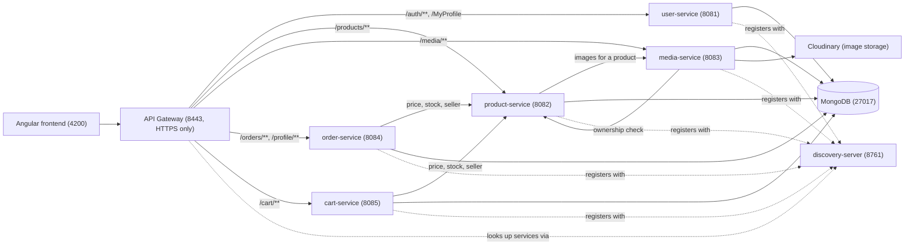

# buy-01

An end-to-end e-commerce platform built as **Spring Boot microservices** behind an API gateway, with an **Angular** frontend. Users register as **clients** or **sellers**. Clients browse and search products, add them to a cart, check out with pay-on-delivery, track their orders, and see their purchase stats. Sellers manage products and photos, fulfill orders, and see their sales stats.

CI/CD runs on **Jenkins**: every PR is built, tested and analysed by **SonarQube** (merge is blocked if either fails); every push to `main` is also deployed to staging, with automatic rollback if the deploy is unhealthy. See [jenkins/CI-CD.md](jenkins/CI-CD.md) for the full pipeline and architecture, and [docs/security.md](docs/security.md) for how auth/authorization/CORS/HTTPS are enforced and verified.

## Table of contents

- [buy-01](#buy-01)
  - [Table of contents](#table-of-contents)
  - [Architecture](#architecture)
  - [Tech stack](#tech-stack)
  - [Project structure](#project-structure)
  - [Services](#services)
    - [user-service](#user-service)
    - [product-service](#product-service)
    - [media-service](#media-service)
    - [cart-service](#cart-service)
    - [order-service](#order-service)
    - [api-gateway](#api-gateway)
  - [Authentication](#authentication)
  - [Getting started](#getting-started)
  - [HTTPS (self-signed, local dev)](#https-self-signed-local-dev)
  - [Environment variables](#environment-variables)
  - [Demo data](#demo-data)
  - [Testing](#testing)
  - [CI/CD and code quality](#cicd-and-code-quality)

## Architecture

Every request from the browser goes through a single entry point, the **API Gateway**, which validates the JWT and forwards the request to the right backend service. Services find each other through the **Eureka** discovery server rather than hardcoded hosts/ports, and each service owns its own MongoDB database.



Each service uses its own database inside the same MongoDB instance: `users_db`, `products_db`, `media_db`, `orders_db`, `carts`.

## Tech stack

**Backend**
- Java 17, Spring Boot 4
- Spring Cloud Gateway (MVC) — routing, JWT validation
- Spring Cloud Netflix Eureka — service discovery
- Spring Data MongoDB
- Spring Security
- Resilience4j — circuit breaker for the product → media call
- Cloudinary SDK — image storage for media-service

**Frontend**
- Angular 21 (standalone components, signals, zoneless change detection)
- Bootstrap 5
- Chart.js — seller/client analytics dashboards
- Vitest — unit tests

**Infra / tooling**
- Docker Compose — local orchestration
- MongoDB 7
- Jenkins — CI/CD pipeline (build → test → SonarQube quality gate → build images → deploy), see [jenkins/CI-CD.md](jenkins/CI-CD.md)
- SonarQube — static analysis and quality gate, one project per service plus one for the frontend

## Project structure

```
buy-01/
├── compose.yml                  # orchestrates every service locally
├── Jenkinsfile                  # build → test → SonarQube gate → build images → deploy
├── jenkins/                     # Jenkins + SonarQube stack (separate compose project), see CI-CD.md
├── docs/                        # security.md, demo-accounts.md
├── scripts/                     # seed.sh, security-check.sh
├── backend/
│   ├── discovery-server/        # Eureka registry
│   │   └── src/main/java/com/ecommerce/discoveryserver/
│   ├── api-gateway/             # single entry point, JWT validation, routing
│   │   └── src/main/java/com/ecommerce/apigateway/
│   │       ├── config/          # routes (incl. cart/orders/profile), CORS, gateway filters
│   │       └── security/        # JWT validation filter
│   ├── user-service/            # accounts, auth, profile
│   │   └── src/main/java/com/ecommerce/userservice/
│   │       ├── controller/      # AuthController, ProfileController
│   │       ├── service/         # AuthService, JwtService, ProfileService
│   │       ├── model/ · repository/
│   │       └── config/          # DataSeeder, SecurityConfig
│   ├── product-service/         # product catalog, search & filtering
│   │   └── src/main/java/com/ecommerce/productservice/
│   │       ├── controllers/     # ProductController (CRUD, search, facets)
│   │       ├── services/        # ProductService, ProductSearchRepository
│   │       ├── clients/         # Feign/REST client to media-service
│   │       ├── models/ · repositories/
│   │       └── security/        # trusts gateway-forwarded user headers
│   ├── media-service/           # product/profile image storage
│   │   └── src/main/java/com/ecommerce/mediaservice/
│   │       ├── controllers/     # MediaController
│   │       ├── services/        # MediaService (validation, Cloudinary calls)
│   │       ├── clients/         # client back to product-service (ownership check)
│   │       ├── models/ · repositories/
│   │       └── security/
│   ├── cart-service/            # per-user shopping cart
│   │   └── src/main/java/com/ecommerce/cartservice/
│   │       ├── controllers/     # CartController (get/add/update/remove/clear)
│   │       ├── services/        # CartService, ProductServiceGateway (live price/stock)
│   │       ├── models/ · repositories/
│   │       └── security/        # HeaderAuthFilter, SecurityConfig
│   └── order-service/           # orders, status flow, user/seller analytics
│       └── src/main/java/com/ecommerce/orderservice/
│           ├── order/           # OrderController, OrderService, OrderSearchService
│           └── analytics/       # UserPurchaseStatsController, SellerSalesStatsController
├── frontend/                    # Angular app
│   └── src/app/
│       ├── core/                 # guards, interceptors, app-wide services
│       ├── features/
│       │   ├── auth/             # login, register
│       │   ├── products/         # list, detail, form, table row, search page
│       │   ├── media/            # <app-upload> picker (components/services/models/utils)
│       │   ├── cart/              # cart page
│       │   ├── checkout/          # address → review → confirm (pay on delivery)
│       │   ├── orders/            # my orders, seller orders, order details
│       │   └── profile/           # account settings + avatar, user/seller analytics dashboards
│       └── shared/                # reusable components (carousel, modal, toasts, ...)
└── .vscode/
```

## Services

| Service | Port | Responsibility |
|---|---|---|
| `discovery-server` | 8761 | Eureka registry all other services register with |
| `api-gateway` | 8443 (HTTPS only) | Single public entry point; validates JWTs and routes to the right service |
| `user-service` | 8081 | Registration, login, profile |
| `product-service` | 8082 | Product CRUD, search & filtering, ownership checks, pagination |
| `media-service` | 8083 | Image upload/delete/lookup, Cloudinary storage |
| `order-service` | 8084 | Orders (create/list/search/cancel/redo/remove), status flow, user & seller analytics |
| `cart-service` | 8085 | Per-user shopping cart |
| `frontend` | 4200 | Angular SPA |
| `mongodb` | 27017 | One shared instance, one database per service |

### user-service
- `POST /auth/register`, `POST /auth/login`
- `GET /MyProfile`, `PUT /MyProfile`
- Issues the JWT on login; passwords hashed with Spring Security's `PasswordEncoder`.

### product-service
- `GET /products`, `GET /products/{id}`, `POST /products`, `PUT /products/{id}`, `DELETE /products/{id}` (create/update/delete are seller-only, own products only).
- `GET /products/search?q=&category=&minPrice=&maxPrice=&sort=&page=&size=` — public keyword search (falls back to a literal, case-insensitive prefix match when the text index returns nothing) plus category and price-range filters, sorting (`relevance`, `price_asc`, `price_desc`, `newest`) and pagination.
- `GET /products/facets` — category counts and the current price min/max, used to build the search filter UI.
- On startup, the service ensures a weighted text index on product names and descriptions and assigns `OTHER` to existing products without a category.
- Fetches each product's image URLs from media-service on read, through a Resilience4j circuit breaker (falls back to an empty image list if media-service is unavailable).

### media-service
- `POST /media/images`, `PUT /media/images`, `DELETE /media/images`, `GET /media/images`, `GET /media/images/{productId}`
- Validates uploads (image type, size, max count per target), stores/removes the file on Cloudinary, and keeps a `Media` record per uploaded image in MongoDB.
- Confirms the caller actually owns the product before allowing a change, by calling back into product-service.

### cart-service
- `GET /cart`, `POST /cart/items`, `PUT /cart/items/{productId}`, `DELETE /cart/items/{productId}`, `DELETE /cart` — one cart per client (`X-User-Id`), never addressable by another user's id.
- The cart only stores `productId` + `quantity`; price, stock and seller are always read live from product-service, so a stale/spoofed price is never possible. Adding or updating an item checks current stock.

### order-service
- `POST /orders` — places an order from a list of `{productId, quantity}` + a shipping address (pay on delivery). One order is created per seller if the cart spans several sellers.
- `GET /orders/my` / `GET /orders/seller` — paginated list for the client or the seller, both filterable by `status`, `from`/`to` (date range) and `q` (free text).
- `GET /orders/{id}` — order detail, with a full `statusHistory` timeline (owner or seller of that order only).
- `PATCH /orders/{id}/status` — seller advances the order one step: `PENDING → CONFIRMED → SHIPPED → DELIVERED`.
- `POST /orders/{id}/cancel` — while `PENDING`/`CONFIRMED` (owner or seller).
- `POST /orders/{id}/redo` — re-orders a `CANCELLED`/`DELIVERED` order (re-checks price/stock); `DELETE /orders/{id}` — removes it from the client's history. Both owner-only.
- `GET /profile/user/stats` — a client's total spent, order count, most-bought products and top categories.
- `GET /profile/seller/stats` — a seller's revenue, units sold, best-selling products and daily revenue, computed with a MongoDB aggregation pipeline.

### api-gateway
- Routes `/auth/**` and `/MyProfile` → user-service, `/products/**` → product-service, `/media/**` → media-service, `/cart/**` → cart-service, `/orders/**` and `/profile/**` → order-service.
- Validates the `Authorization` bearer JWT and forwards the authenticated user's id/role downstream as `X-User-Id` / `X-User-Role` headers, so individual services never re-verify the JWT themselves.

## Authentication

1. The client logs in through `user-service`, which returns a signed JWT.
2. The frontend attaches that JWT as a `Bearer` token on every request (see `core/interceptors/auth.interceptor.ts`).
3. `api-gateway` validates the token and, on success, injects `X-User-Id` and `X-User-Role` headers before forwarding the request.
4. Every downstream service (`product-service`, `media-service`, `cart-service`, `order-service`) never sees the JWT — each trusts those two headers (set only by the gateway, which strips any client-supplied copy) to populate its own security context and enforce role/ownership checks. Full details and how to verify them: [docs/security.md](docs/security.md).

## Getting started

**Prerequisites:** Docker and Docker Compose.

```bash
git clone https://github.com/ayoubnachti/buy-01.git
cd buy-01
cp .env.example .env   # fill in JWT_SECRET and CLOUDINARY_URL
docker compose up --build
```

This starts, in order: `mongodb` → `discovery-server` → the five backend services (`user-service`, `product-service`, `media-service`, `order-service`, `cart-service`) → `api-gateway` → `frontend`.

Once healthy:
- Frontend: http://localhost:4200
- API Gateway: https://localhost:8443 (HTTPS only — see [HTTPS](#https-self-signed-local-dev))
- Eureka dashboard: http://localhost:8761

To run a single backend service outside Docker (e.g. for debugging), each one is a standalone Maven project under `backend/`:

```bash
cd backend/product-service
./mvnw spring-boot:run
```

## HTTPS (self-signed, local dev)

`api-gateway` serves over HTTPS on port `8443` using a self-signed certificate —
this is the only service with TLS; every other service stays on plain HTTP
behind it, since nothing outside the Docker network can reach them directly
(only `gateway:8443` and `discovery:8761` are exposed to the host).

### Generating the keystore (already done once — regenerate if needed)

```bash
keytool -genkeypair \
  -alias gateway \
  -keyalg RSA \
  -keysize 2048 \
  -storetype PKCS12 \
  -keystore keystore.p12 \
  -validity 3650 \
  -dname "CN=localhost, OU=Dev, O=Vendify" \
  -storepass changeit \
  -keypass changeit
```

Notes on the flags:
- `-storepass` / `-keypass` must be **identical** for a PKCS12 keystore —
  the format doesn't support a separate per-entry key password the way
  older JKS keystores did. `keytool` will warn (or reject) if they differ.
- `-dname "CN=localhost, ..."` sets all the identity fields non-interactively
  in one go — omit it and `keytool` prompts for each field one at a time,
  plus a yes/no confirmation, which is fine by hand but not reproducible
  in a script or a teammate following these instructions blind.
- If you're on **Windows using Git Bash**, this command has an advantage
  worth knowing about: `openssl`'s equivalent needs a `-subj` value starting
  with `/` (e.g. `/CN=localhost`), which Git Bash's automatic Unix-path
  conversion mangles before `openssl` ever sees it. `keytool`'s `-dname`
  value has no leading `/`, so it isn't affected by that conversion at all.

Update `SSL_KEYSTORE_PASSWORD` in `.env` to match `-storepass` if you
change it from `changeit`, and `SSL_KEYSTORE_PATH` if you move the file
somewhere other than the default `classpath:keystore.p12`.

Place `keystore.p12` at `backend/api-gateway/src/main/resources/keystore.p12` —
Maven packages it into the built JAR from there, no separate volume
mount needed for the default classpath-based setup.

## Environment variables

All variables below are set in one root `.env` (copy it from `.env.example`, never committed).

| Variable | Used by | Default | Notes |
|---|---|---|---|
| `USER_MONGODB_URI`, `PRODUCT_MONGODB_URI`, `MEDIA_MONGODB_URI`, `ORDER_MONGODB_URI`, `CART_MONGODB_URI` | matching service | `mongodb://mongodb:27017/<service>_db` | One database per service, same MongoDB instance |
| `EUREKA_CLIENT_SERVICEURL_DEFAULTZONE` | all services | `http://discovery-server:8761/eureka` | Points every service at the discovery server |
| `JWT_SECRET` | user-service, api-gateway | *(required, no default)* | Must be identical between the two — generate with `openssl rand -base64 32` |
| `SSL_KEYSTORE_PATH` | api-gateway | `classpath:keystore.p12` | See [HTTPS](#https-self-signed-local-dev) |
| `SSL_KEYSTORE_PASSWORD` | api-gateway | `changeit` | Must match the `-storepass` used to generate `keystore.p12` |
| `CLOUDINARY_URL` | media-service | *(required, no default)* | Get it from your Cloudinary dashboard |
| `CORS_ALLOWED_ORIGIN` | api-gateway | `http://localhost:4200` | Frontend origin allowed through CORS |
| `APP_PROFILE` | all Compose services | `prod` | Set to `dev` or `staging` for the demo seed; the seed refuses other profiles |

## Demo data

Use `./scripts/seed.sh` to reset and reseed the reserved demo accounts, 30
products, and 40 orders. The command verifies the active profile in the running
Compose services and refuses to run outside `dev` or `staging`. It uses the real
product and order APIs and local placeholder product images. See
[docs/demo-accounts.md](docs/demo-accounts.md) for credentials, reset behavior,
and setup instructions.

## Testing

- Backend: each service has its own JUnit test suite — `./mvnw test` from inside `backend/<service>/`.
- Frontend: `cd frontend && npm test` (Vitest) — unit and component tests, including HTTP-mocked service tests.
- Security: `./scripts/security-check.sh` logs in as a demo client and seller and checks every auth/role/ownership rule in [docs/security.md](docs/security.md) against the running stack.

## CI/CD and code quality

Every PR is built, tested and analysed by Jenkins and SonarQube; a PR can't be merged if a test or the quality gate fails. Every push to `main` is additionally deployed to staging, with automatic rollback if the new release's health check fails. A nightly build re-runs tests and analysis on `main` without redeploying.

Pipeline stages (`Jenkinsfile`): **Prepare → Build & test (backend JUnit/JaCoCo + SonarQube per service, frontend Vitest + SonarQube, in parallel) → Build images → Deploy** (the last two only on `main`).

Full pipeline architecture, Jenkins/SonarQube setup and live URLs: [jenkins/CI-CD.md](jenkins/CI-CD.md).
